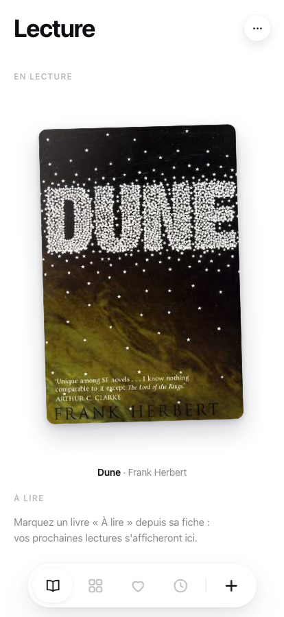
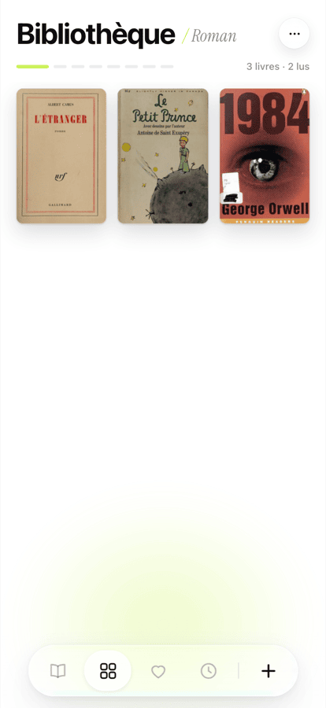
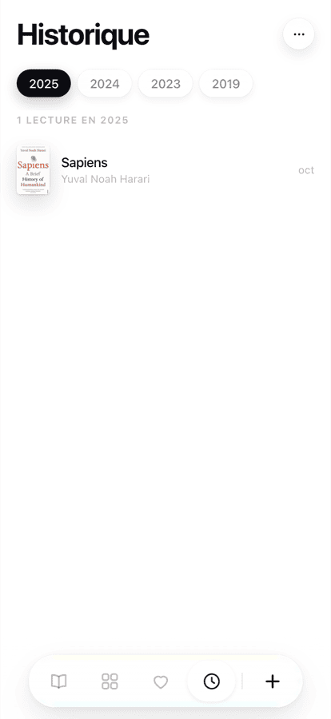

# Bibliothèque

Une app pour suivre ce qu'on lit. Sur papier.

Pas de note sur 5, pas de fil d'actualité, pas de compte à créer. Tu photographies la couverture, le livre entre dans ta bibliothèque, et tu retrouves des années plus tard la trace de ce que tu lisais cet été-là.

**Ta bibliothèque t'appartient.** Tu l'installes chez toi, sur ton hébergement, avec ton mot de passe. Personne d'autre n'y accède — pas même nous.

  
  
  

---

## Installer

Dix minutes, deux comptes gratuits (GitHub et Vercel), aucune carte bancaire.

### En un clic

Vercel te fait créer ta copie, te demande un mot de passe, et fabrique tout le reste. Tu repars avec ta propre adresse et ta bibliothèque synchronisée entre ton téléphone et ton ordinateur.

Prépare ton mot de passe avant de cliquer — il te sera demandé en cours de route, et c'est lui qui protégera ta bibliothèque.

### Ou laisse ton IA le faire

Si tu utilises Claude, ChatGPT ou équivalent, copie-lui ce message :

> Installe cette application pour moi : https://github.com/go-silex/silex-bookworm
> Suis les instructions du fichier INSTALL.md, et pose-moi les questions au fur et à mesure.

Le dépôt contient un guide écrit spécialement pour être lu par une IA : chaque étape, chaque erreur possible et son remède. Tu n'as rien à comprendre, juste à répondre à ce qu'on te demande.

Le détail pas à pas est dans **[INSTALL.md](INSTALL.md)**.

### Pourquoi Vercel et rien d'autre

L'app est du HTML et du JavaScript sans étape de build : GitHub Pages ou Netlify l'afficheraient très bien. Mais ils n'exécutent pas de code serveur, et c'est le serveur qui garde tes livres. Sans lui, chaque navigateur a sa propre bibliothèque, vider le cache efface tout, et aucune sauvegarde n'est possible.

Ça marche magnifiquement pendant six mois, puis on perd deux cents livres sans avoir rien fait de mal. D'où le chemin unique.

---

## Ce que ça fait

**Quatre écrans**, qui glissent horizontalement.

- **Lecture** — ce que tu lis en ce moment, et la pile de ce qui t'attend.
- **Bibliothèque** — tes livres rangés par genre, un chapitre par genre.
- **Favoris** — ceux qui comptent.
- **Historique** — une page par année. C'est là que l'app devient intéressante avec le temps.

**Ajouter un livre.** Tu cherches par titre, ou tu photographies la couverture. L'app lit le code-barres s'il y en a un, sinon elle déchiffre la couverture (voir plus bas). Les couvertures arrivent toutes seules, depuis Open Library et Google Books.

**Les relectures comptent.** Un livre lu trois fois apparaît trois fois dans l'historique, aux trois bonnes dates. C'était le point de départ du projet.

**Ça s'installe comme une app.** Sur iPhone : Partager → *Sur l'écran d'accueil*. Ça s'ouvre en plein écran, sans barre de navigateur.

---

## Bien démarrer

**Vider la bibliothèque de démonstration.** L'app arrive avec six livres d'exemple pour que tu voies à quoi ça ressemble. Menu **⋯** en haut à droite → **Vider la bibliothèque**.

**Le scan de couverture** (facultatif) demande une clé Google Gemini, gratuite, à créer sur [aistudio.google.com](https://aistudio.google.com/apikey). Tu l'ajoutes **une seule fois** dans les réglages Vercel (`GEMINI_API_KEY`) et le scan marche ensuite sur tous tes appareils — rien à coller sur ton téléphone. Sans elle, la recherche par titre fonctionne très bien.

**Ton mot de passe.** Il n'y a pas de « mot de passe oublié » : personne ne peut le retrouver à ta place, note-le quelque part. Tu peux le changer quand tu veux sans rien perdre — Vercel → ton projet → Settings → Environment Variables → `LIBRARY_PASSWORD`, puis redéployer.

---

## Sous le capot

Trois fichiers, aucun framework, aucune étape de build.

| | |
|---|---|
| `index.html` | 30 lignes de squelette |
| `app.js` | toute l'application |
| `style.css` | tout le style |
| `glass.js` | l'effet de verre liquide (Chromium uniquement, dégradé ailleurs) |
| `api/library.js` | la synchronisation — la seule partie serveur, 55 lignes |

**Le modèle de données.** Un livre a un titre, un auteur, un genre, et une liste de *sessions* de lecture (`startedAt` / `finishedAt`). Tout le reste en découle : le statut se déduit de la dernière session, l'historique est la liste de toutes les sessions terminées.

**La synchronisation.** Le navigateur garde tout en `localStorage` et pousse vers `/api/library`, protégé par un mot de passe unique. Sans serveur configuré, l'API répond `501` et l'app continue en local sans rien dire. Les bibliothèques de deux appareils fusionnent au lieu de s'écraser : les livres se réunissent par titre, les sessions par date de fin. Rien n'est perdu, rien n'est doublé.

---

## English

A reading tracker for paper books. No ratings, no feed, no account — you deploy your own copy and it's yours.

**Install:** click the Vercel button above (two free accounts, ~10 min, no credit card), or hand the repo to your AI assistant with *"install this for me, follow INSTALL.md"*. Step-by-step instructions live in **[INSTALL.md](INSTALL.md)**.

Vercel is the only supported target, on purpose. The app is plain static files and would render fine on GitHub Pages — but those hosts run no server code, and the server is what keeps your books. Without it every browser holds its own separate library, clearing the cache wipes it, and no backup is possible.

**Note:** the interface is in French. The code is plain vanilla JS with no build step, so translating it means editing string literals in `app.js` — contributions welcome.

**How it works:** four swipeable views (reading, library by genre, favourites, history by year). Books are added by title search or by photographing the cover — barcode first, then a Gemini vision fallback if you supply a free API key. Covers are fetched from Open Library and Google Books. Re-reads are first-class: each reading session is stored separately, so a book read three times shows up three times in your history.

**Data:** stored in `localStorage`, optionally synced to a Vercel Blob store behind a single shared password. Static deployments have no server — your data lives in the browser cache only.

---

## Contribuer

Les issues et les pull requests sont bienvenues. Le projet est volontairement minimal : pas de dépendance côté navigateur, pas de build, pas de framework. Une contribution qui ajoute un `node_modules` au client sera probablement refusée avec le sourire.

Quelques pistes ouvertes : export / import JSON, traduction de l'interface, thème sombre.

## Licence

MIT — voir [LICENSE](LICENSE).

Construit par [GOSILEX](https://gosilex.com).
